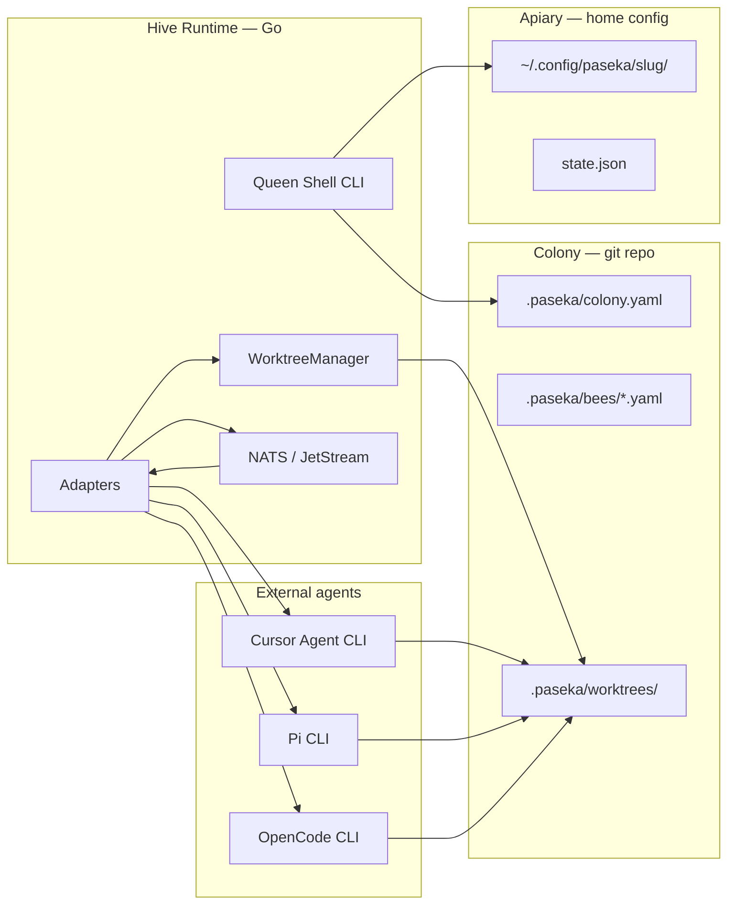

# Architecture overview

Adapters, run IPC, worktrees / code proposals, end-to-end flow, and Go package layout.

Interactive map of the Hive Runtime (Queen Console → NATS → Reactor → adapters): **[Paseka Hive Runtime](paseka-runtime.html)**. The HTML is generated in docs CI from [`paseka-runtime.architecture.json`](paseka-runtime.architecture.json); locally run `scripts/render-archify.sh`.

Colony config layout and `paseka init`: [Colony layout](../guide/colony-layout.md).

## 1. Agent adapters

An **adapter** is a thin driver: prepare workspace → invoke external tool → normalize result → emit bus events.

Paseka does **not** implement agents. It launches ready-made solutions with the right cwd, prompt, and parameters.

### Adapter interface (Go)

```go
type Adapter interface {
    Name() string
    Run(ctx context.Context, req RunRequest) (*RunResult, error)
}

type RunRequest struct {
    Bee        string
    Prompt     string
    ColonyRoot string            // git root — runs/ always under colony
    Workspace  string            // cwd for adapter (repo root or worktree)
    Params     RunParams
    TraceID    string            // flight trail for the whole task chain
    AgentID    string            // unique id per spawned agent
}

type RunResult struct {
    Status   string            // completed | failed | cancelled
    Output   string            // stdout / final assistant text
    Artifacts []Artifact       // diffs, logs, structured JSON
    ExitCode int
}
```

Adapters live under `internal/adapters/<name>/`. Registration is declarative via `adapter` field in bee config.

How a bee becomes a binary, argv, and env — config layer precedence (repo, profile, machine-local), `params` vs `command`, credentials, and the single-resolver model: **[Adapter launch resolution](../reference/adapter-launch-resolution.md)**.

### 1.1 File-based agent IPC (`runs/`)

Each spawned agent gets an isolated directory under the **colony root** (not inside a worktree), so results survive worktree cleanup and multiple agents can share one `traceId`.

```
.paseka/runs/<traceId>/<agentId>/
├── prompt.txt         # runtime → agent: rendered prompt_template (audit / replay)
├── system.txt         # optional — rendered system_template (adapter injection)
├── summary.md         # runtime log: human-readable summary (not a success contract)
├── request.json       # runtime → observers: the resolved launch — adapter, model, profile, launchForm
├── meta.json          # adapter → observers: bee, adapter, workspace, profile, startedAt, providerSessionId
├── status.json        # runtime → observers: completed|failed, exitCode, finishedAt
├── session.json       # interactive only: pid, state, session metadata
└── transcript.ndjson  # interactive only: dialogue audit log
```

One record per Flight Trail, beside the run directories rather than inside one
of them:

```
.paseka/runs/<traceId>/trail-events.ndjson   # the trail's history — see below
```

Task ledger projection (updated by `paseka run`):

```
.paseka/runs/<traceId>/tasks/<taskId>/
├── task.md            # markdown + YAML frontmatter task snapshot
└── runs.ndjson        # links task executions to agent run directories
```

Trail comb (trace-scoped handoff files; gitignored with `runs/`):

```
.paseka/runs/<traceId>/artifacts/
├── research.md        # bee-written draft notes (example)
└── review-comments.md # human Console comb write (017 Slice B)
```

Bees receive `{{.ArtifactsDir}}` (absolute path to the comb). Runtime announces **added/changed** comb files on successful AFK or interactive exit via `SIGNAL/artifact.written` (SHA-256 delta vs per-run baseline under `<agentId>/artifacts-baseline.json`). Human producers (`console`) write and publish immediately. Distinct from adapter `result.json` artifact blobs and Object Store mutation refs — see [Spec 014](../specs/014-artifacts-protocol.md).

| ID | Scope | Generated by |
| -- | ----- | ------------ |
| `traceId` | Whole flight trail — one bloom/nectar chain | runtime (`colony.NewTraceID`: `trace-` + 16 hex, time-ordered) |
| `agentId` | Single adapter invocation (one `agent` process) | runtime (random hex) |

**`request.json` is the resolved launch, written once at resolution time.** The runtime fills it from the single `launch.ResolveLaunch` call that assembles every layer, so it carries `model` — the model id after `model_aliases` substitution, with any deprecated `params.provider` folded in and before the per-adapter argv split — plus `modelAlias` (the alias key the bee declared, when it was one), `profile`, and `launchForm`. This is the only place a run's model is recorded, and it is the reason one can be recovered: the bee's `params`, the machine-local adapter layer, the selected profile, and the alias table are all live config that changes after the fact, so re-deriving the model from them answers a different question. An empty `model` on a `command` or `script` bee means the argv came from the bee and named no model — not that the adapter fell back to a default; `launchForm` says which case it is. `modelAlias` is recorded for the same forensic reason but is not yet projected into the console or an export.

**Why colony root, not worktree:** code edits happen in `.paseka/worktrees/<traceId>/`, but agent I/O and audit trail live in `.paseka/runs/<traceId>/<agentId>/`. Prompt uses an **absolute path** to `summary.md` so Cursor CLI writing from a worktree cwd still lands in the colony runs dir.

Entire `runs/` tree is **gitignored** — ephemeral, machine-local artifacts.

Implementation: `internal/runs/` prepares directories and files; adapters may still read legacy `result.txt` content for summary normalization, but run success no longer depends on it. Runtime writes new runs to `summary.md`. Runtime auto-synthesizes `INSIGHT/run.summary` when policy allows. Domain events are published by agents through `paseka event emit --stdin`, not by parsing assistant stdout.

**Event publish path (MVP):**

```text
agent -> paseka event emit --stdin -> validation -> NATS/JetStream
```

Agents build one JSON object per event, pass it on stdin, and receive machine-readable validation/publish feedback.

**The per-run log** — `.paseka/runs/<traceId>/<agentId>/events.ndjson` — is the audit of what one run published. It is per-attempt: the run launcher deletes and recreates it on every dispatch, so a retried or explicitly identified run replaces its predecessor's file. `paseka event emit` appends there after a successful publish when the event includes the correct `traceId` and `agentId`, and a script bee writes to it through `PASEKA_EVENT_LOG`.

**The trail record** — `.paseka/runs/<traceId>/trail-events.ndjson` — is the whole-trail history: every domain event the colony decided to publish for that trail, whoever produced it. It is written by the publisher seam on the way to the bus, not by each publishing site, so the runtime, the task ledger, the honey reserve, the review gate, the cue layer, the console, the Human Gateway, and the CLI are all covered by one writer; an operator signal, a console action, or an explain run that has no run directory of its own still lands somewhere. The name differs from the per-run log deliberately: a path fragment gets quoted on its own — in an error, in documentation, in a console action — where the directory it came from is no longer in view, and an audit tool that quietly answers with the wrong half is the worst kind of wrong.

**What the trail record is not.** It is the colony's account of what it decided to do, not proof of what was broadcast. The write happens before the broker attempt, so an event it holds may still have failed to reach the bus; nothing marks that state on the record. Compare the trail against the stream with `paseka verify <traceId>` to answer it.

Only domain events are recorded — `SIGNAL`, `INSIGHT`, `MUTATION`, `VERIFICATION`, the same test that gates the bus. `LOG`, `PROGRESS`, `TOOL_CALL`, and `ASSISTANT_TEXT` are run-lifecycle diagnostics and stay out of the trail's history.

Both files are written by appending a line at a time, so a reader skips a line that will not parse — a process that dies mid-append leaves a torn last line, and everything before it is history the colony actually has. The skip is logged with the file and line number.

Every trail surface reads the record: the timeline, `paseka export`, prompt memory, trail titles and summaries, worktree branch and pull-request body resolution. A trail-scoped read merges the record with the per-run logs and collapses an event that sits in both by its identity, so the two storage locations never double a row. A colony-wide read costs one file per trail instead of every run log in every scanned trail. Nothing here needs a broker.

**Optional MCP layer:** a future MCP tool may wrap the same validation/publish backend used by `paseka event emit`. MCP is not required for the base contract.

### Example: Cursor adapter (CLI)

**Decision:** invoke the **Cursor Agent CLI** (`agent`), not the SDK. Prototype: `fizman-parent/scripts/ai-tasks-run.sh` (tmux wrapper → simplified in Go via `exec`).

| Input (bee config + event) | Maps to `agent` flag |
| ---------------------------- | -------------------- |
| `command` (optional) | full argv; overrides `params` mapping (see [bee config](../guide/bee-config.md)) |
| `Workspace` | `--workspace <path>` (repo root or `.paseka/worktrees/<traceId>/`) |
| `Prompt` | positional prompt argument (`system_template` + task, newline-separated, when system is set) |
| `params.model` | `--model <id>` (resolved vendor id after `model_aliases` lookup) |
| `params.yolo` (default true) | `--trust --force` (suppressed when `params.plan`) |
| output format (runtime-owned) | `--output-format stream-json` (unless `bee run --raw`) |
| `params.plan` | `--plan` |
| API key | `CURSOR_API_KEY` env or `--api-key` from home config |

Default non-interactive invocation (same spirit as fizman script):

```bash
agent -p --trust --force \
  --workspace "$WORKSPACE" \
  --output-format stream-json \
  "$PROMPT"
```

**Result collection:**

1. **Process outcome** — adapter reports exit/cancel status; runtime may downgrade via `completion_contract` and per-bee `run_summary` policy.
2. **Run summary** — runtime auto-publishes `INSIGHT/run.summary` when allowed and missing; agents may emit it explicitly via `paseka event emit`.
3. **Log artifact** — runtime writes normalized summary to `summary.md` for human inspection.
4. **Git diff** — after `agent` exits, capture a **baseline-attributed** tracked diff in the **workspace** (worktree or repo root). Pre-existing dirty files are not attributed to the run.
5. **Stream JSON** — stdout, because the runtime always requests `--output-format stream-json` (lifecycle/diagnostic parse only; domain events are not extracted from assistant text). When the final `result` line includes `usage` (`inputTokens`, `outputTokens`, `cacheReadTokens`, `cacheWriteTokens`), the adapter persists it on `result.json` as optional `usage` (source `cursor.stream-json`). When stream (or compact JSON) lines include `session_id`, the adapter persists **`providerSessionId`** on `result.json` and `meta.json` so later export/inspect can associate the run with Cursor’s native chat without copying the vendor store. `paseka export --include agent-logs` resolves a per-run **Agent log** through `SessionLogResolver` at read time: Cursor reads `~/.cursor/projects/<slug>/agent-transcripts/<uuid>/<uuid>.jsonl` (UUID = `providerSessionId`; workspace slug first, then glob). Missing provider data never fails export. Pi still stubs that seam. Adapters without usage omit the field; Honey Reserve (`energyToken`) stays dispatch-count based and is unrelated.
6. **status.json** — runtime records exit code and outcome for `paseka inspect` / Queen Console.

Go implementation: `internal/adapters/cursor/` runs `agent` with `exec.CommandContext` (no tmux — process wait replaces the shell's `tmux wait-for` pattern).

Optional: Cursor's built-in `--worktree` flag exists but Paseka prefers **`.paseka/worktrees/<traceId>/`** under colony control for HITL merge/reject.

### Example: Pi adapter (CLI)

**Decision:** invoke the **Pi CLI** (`pi`) for bees configured with `adapter: pi`. AFK runs use `pi -p`; interactive sessions use `pi` under a Paseka-owned PTY (see [interactive sessions](../guide/interactive-sessions.md)).

| Input (bee config + event) | Maps to `pi` flag |
| ---------------------------- | ----------------- |
| `command` (optional) | full argv; overrides `params` mapping (see [bee config](../guide/bee-config.md)) |
| `Workspace` | process cwd |
| `Prompt` | positional prompt argument |
| run directory | `--session-dir <runDir>/pi-sessions` (AFK and interactive) |
| `agentId` | `--session-id <agentId>` (AFK and interactive) |
| `params.model` | `--model <pattern>`; a `vendor/model[:suffix]` id splits at the **first** `/` into `--provider <vendor> --model <rest>`, keeping inner slashes and colon suffixes |
| `params.reasoning` | `--thinking <level>` |
| output format (runtime-owned) | `--mode json` (AFK; `text` only under `bee run --raw`) |
| `params.plan` | `--plan` |
| `params.binary` | CLI binary name (default `pi`) |
| API key | `api_key_env` from `~/.config/paseka/<slug>/adapters/pi.yaml` → `--api-key` |

Default non-interactive invocation:

```bash
pi -p --mode json \
  --session-dir "$RUN_DIR/pi-sessions" \
  --session-id "$AGENT_ID" \
  --model "$MODEL" \
  --provider "$PROVIDER" \
  "$PROMPT"
```

**Ignored params:** Pi has no `yolo` equivalent (no `--trust`/`--force` flag); `paseka doctor` warns when `params.yolo` is set.

**Result collection:**

1. **Process outcome** — adapter reports exit/cancel status; runtime may downgrade via `completion_contract` and per-bee `run_summary` policy.
2. **Run summary** — runtime auto-publishes `INSIGHT/run.summary` when allowed and missing; agents may emit it explicitly via `paseka event emit`.
3. **Log artifact** — runtime writes normalized summary to `summary.md` for human inspection.
4. **Git diff** — after `pi` exits, capture a **baseline-attributed** tracked diff in the **workspace** (worktree or repo root).
5. **Stdout** — raw stdout is preserved as an artifact. In `json`/`rpc` modes the adapter tolerantly extracts a human summary from common JSON fields (`summary`, `output`, `text`, etc.) for `summary.md` only. A native session id is resolved from the JSON session header (`{"type":"session","id":…}`) when present, otherwise from `--session-id` on the argv, and persisted as **`providerSessionId`** on `result.json` and `meta.json`. `command:` overrides do not inject session flags; association then depends on stdout or flags already in the custom argv. Export Agent log uses the same optional `SessionLogResolver` seam as Cursor (Pi is stubbed until session-dir readers land).
6. **Token usage** — optional `usage` on `result.json`. In `--mode json` the adapter sums each assistant turn's `message_end` usage (`message_update` deltas repeat the same running totals, so they are not counted; tool results carry tool-level usage and are skipped) — source `pi.print-json`. When stdout carries no usage (`text`, `rpc`, or a JSON stream without events) the adapter falls back to the run-scoped session file(s) under `--session-dir`, counting assistant messages plus standalone spend (`usage` cache-warm entries) and compaction summaries — source `pi.session-jsonl`. Both are cumulative for the session file, so a resumed session includes earlier turns. `command:` overrides skip the fallback because the session dir is then not ours.
7. **status.json** — runtime records exit code and outcome for `paseka inspect` / Queen Console.

**Event publishing boundary:** Pi stdout/JSON is **not** parsed into domain bus events (`SIGNAL`, `INSIGHT`, `MUTATION`, `VERIFICATION`). Agents must publish domain events explicitly via `paseka event emit --stdin` — same contract as Cursor.

**Machine-local config** (`~/.config/paseka/<slug>/adapters/pi.yaml`):

```yaml
binary: pi
api_key_env: GEMINI_API_KEY   # optional; passed as --api-key when set in env
```

If the file is missing, defaults are `binary: pi` and no API key injection.

Example bee config:

```yaml
# .paseka/bees/scout.yaml
role: scout
adapter: pi
params:
  model: google/gemini-2.5-pro
  reasoning: high
prompt_template: scout.md
```

Go implementation: `internal/adapters/pi/`.

### Example: Claude Code adapter (CLI)

**Decision:** invoke the **Claude Code CLI** (`claude`) for bees configured
with `adapter: claude`. AFK runs use print mode; interactive sessions use the
Claude TUI through the shared PTY session layer.

| Input | Maps to Claude Code |
| ----- | ------------------- |
| `command` (optional) | full argv override |
| `Workspace` | process cwd |
| Prompt | positional prompt after `-p` |
| `system_template` | `--append-system-prompt-file <runDir>/system.txt` |
| `params.model` | `--model <id>` |
| output format (runtime-owned) | `--output-format stream-json --verbose` |
| `params.plan` | `--permission-mode plan` |
| `params.yolo` (unless `params.plan`) | `--permission-mode bypassPermissions` |
| default permissions | `--permission-mode acceptEdits` |
| API key | `ANTHROPIC_API_KEY` from machine-local adapter config |

Default non-interactive shape:

```bash
claude -p --output-format stream-json --verbose \
  --permission-mode bypassPermissions \
  --append-system-prompt-file "$RUN_DIR/system.txt" \
  "$PROMPT"
```

The adapter records process outcome, normalized summary, stdout/stderr, git
diff, `result.json`, and `status.json`. Stream JSON is parsed for lifecycle
events and summary only; domain choreography should still be emitted through
`paseka event emit --stdin`. Machine-local overrides live in
`~/.config/paseka/<slug>/adapters/claude.yaml`.

Go implementation: `internal/adapters/claude/`.

### Example: OpenCode adapter (CLI)

**Decision:** invoke the **OpenCode CLI** (`opencode`) for bees configured with `adapter: opencode`. AFK runs use `opencode run`; interactive sessions use the OpenCode TUI under a Paseka-owned PTY (see [interactive sessions](../guide/interactive-sessions.md)).

| Input (bee config + event) | Maps to `opencode` flag |
| ---------------------------- | ----------------------- |
| `command` (optional) | full argv; overrides `params` mapping (see [bee config](../guide/bee-config.md)) |
| `Workspace` | `--dir <path>` (AFK `run`) and process cwd (AFK and HITL) |
| Prompt + `system_template` | joined into one message (OpenCode has no append-system flag) |
| `params.model` | `--model <id>` (OpenCode consumes a native `provider/model` id) |
| `params.yolo` (AFK, unless `params.plan`) | `--auto` |
| `params.plan` | `--agent plan` (built-in read-only Plan primary; not Paseka `agentId`) |
| output format (runtime-owned) | AFK `--format json` (`default` only under `bee run --raw`) |
| `params.reasoning` | `--variant` (reasoning effort) |
| `params.binary` | CLI binary name (default `opencode`) |
| Auth | `opencode auth login`, provider env, or project `.env` (no `--api-key`) |
| `agentId` (AFK) | `--title <agentId>` for later list correlation |

Default non-interactive invocation:

```bash
opencode run --format json --dir "$WORKSPACE" --auto --title "$AGENT_ID" \
  -- "$PROMPT"
```

**Ignored / HITL differences:** Interactive sessions omit `run`, `--dir`, `--format`, `--auto`, and `--title`; workspace is process cwd. Permission prompts stay in the TUI.

**Result collection:**

1. **Process outcome** — adapter reports exit/cancel status; runtime may downgrade via `completion_contract` and per-bee `run_summary` policy.
2. **Run summary** — runtime auto-publishes `INSIGHT/run.summary` when allowed and missing; agents may emit it explicitly via `paseka event emit`.
3. **Log artifact** — runtime writes normalized summary to `summary.md` for human inspection.
4. **Git diff** — after `opencode` exits, capture a **baseline-attributed** tracked diff in the **workspace**.
5. **Stdout** — raw stdout is preserved as an artifact. In JSON format the adapter tolerantly reads `sessionID`, last `text` part for `summary.md`, and last `step_finish` `part.tokens` as optional `usage` (source `opencode.run-json`). The native id is persisted as **`providerSessionId`** on `result.json` and `meta.json`. HITL pre-creates the id (`opencode serve` + `POST /session`) and launches the TUI with `--session`, delivering the kickoff through the TUI's own loopback control server (`/session/<id>/prompt_async`) because the TUI ignores `--prompt` with `--session`. Export Agent log is unsupported in this slice (omit quietly).
6. **Token usage (HITL)** — a TUI has no machine-readable stdout and its control server dies with the process, so after the session exits the adapter starts a throwaway `opencode serve` and reads the session's cumulative `tokens` from `GET /session/<id>` — source `opencode.server-json`, persisted as `usage` on `session.json`. Totals are cumulative for that provider session, so a resumed session includes earlier turns. An answer that reports nothing means no usage, never a failure.
7. **status.json** — runtime records exit code and outcome for `paseka inspect` / Queen Console.

**Event publishing boundary:** OpenCode JSON is **not** parsed into domain bus events. Agents must publish via `paseka event emit --stdin`.

**Machine-local config** (`~/.config/paseka/<slug>/adapters/opencode.yaml`):

```yaml
binary: opencode
```

If the file is missing, default is `binary: opencode`.

Example bee config:

```yaml
# .paseka/bees/scout.yaml
role: scout
adapter: opencode
params:
  model: anthropic/claude-sonnet-4
prompt_template: scout.md
```

Go implementation: `internal/adapters/opencode/`.

### Script adapter (bash / python / custom)

**Decision:** bees with `adapter: script` run a **declared command** (bash, python, Go binary, etc.) instead of an LLM CLI. Use for deterministic eval bees (oracle guard, fault-injecting builder), CI hooks, and other signal-driven automation.

Script bees are **AFK-only** (`paseka bee run`); `bee chat` remains LLM-only.

```yaml
# .paseka/bees/oracle-guard.yaml
role: oracle-guard
adapter: script
command: ./scripts/oracle-guard.sh
run_summary: disabled
subscribes:
  - type: MUTATION
    kind: code.proposal.isolated
    dispatch: direct
publishes:
  - type: VERIFICATION
    kind: verification.success
  - type: VERIFICATION
    kind: verification.failed
```

**Requirements:**

- `command:` is **required** (shell-like string or YAML argv list).
- `prompt_template` is **optional** — when omitted, no colony default is applied; when set, the rendered prompt is written to `prompt.txt` and available as `$PROMPT`.
- `params` are ignored (runtime logs a warning if both `command` and `params` are set).

**Process environment** (in addition to `command` variable substitution):

| Variable | Value |
| -------- | ----- |
| `PASEKA_TRACE_ID` | current `traceId` |
| `PASEKA_AGENT_ID` | this invocation id |
| `PASEKA_TASK_ID` | task id when dispatched from ledger |
| `PASEKA_WORKSPACE` | adapter cwd (repo root or worktree) |
| `PASEKA_COLONY_ROOT` | git repo root |
| `PASEKA_RUN_DIR` | `.paseka/runs/<traceId>/<agentId>/` |
| `PASEKA_BEE` | bee role name |
| `PASEKA_EVENT_LOG` | path to `events.ndjson` |
| `PASEKA_RESULT_FILE` | path to `summary.md` |
| `PASEKA_PROMPT_FILE` | path to `prompt.txt` |

**Emitting events:** scripts publish domain events the same way LLM agents do — pipe JSON to `paseka event emit --stdin`:

```bash
paseka event emit --stdin <<EOF
{"traceId":"$PASEKA_TRACE_ID","agentId":"$PASEKA_AGENT_ID","type":"VERIFICATION","payload":{"kind":"verification.failed","summary":"tests failed"}}
EOF
```

**Run outcome:**

1. Non-zero exit → `failed` status (same as LLM adapters).
2. Stdout (trimmed) → run summary when non-empty.
3. Git diff in workspace → auto `MUTATION/code.proposal.isolated` or `code.proposal.root` when the bee declares the matching kind in `publishes` (worktree ↔ kind invariant; see §2).
4. Domain events are **not** synthesized from exit codes — the script must call `paseka event emit`.

Go implementation: `internal/adapters/script/`.

Future adapters (same contract): `aider`, custom wrappers.

### 1.2 Interactive sessions (HITL)

For human-in-the-loop dialogue, Paseka uses a **parallel** session path alongside one-shot `Adapter.Run()`. See [interactive sessions](../guide/interactive-sessions.md).

| Mode | CLI | Adapter API |
| ---- | --- | ----------- |
| AFK | `paseka bee run <role>` | `Adapter.Run()` — Cursor: `agent -p`; Pi: `pi -p`; OpenCode: `opencode run` |
| Interactive | `paseka bee chat <role>` | `SessionAdapter.SessionCommand()` — Cursor: `agent` without `-p`; Pi: `pi` without `-p`/`--mode`; OpenCode: TUI without `run`, PTY-owned by runtime |

Interactive runs add `session.json` and `transcript.ndjson` under the same `.paseka/runs/<traceId>/<agentId>/` tree. Cursor HITL pre-creates a chat (`agent create-chat`) and launches the TUI with `--resume`; OpenCode HITL pre-creates a session (`opencode serve` + `POST /session`, no model turn), launches the TUI with `--session` plus its own loopback control server, and posts the kickoff to `/session/<id>/prompt_async`. **Resume** skips pre-create for both and reuses the stored `providerSessionId` on a new Paseka session (`resumedFrom` on meta). Pi HITL pins `--session-id <agentId>`. The native id is stored as **`providerSessionId`** on `session.json` and `meta.json` before the PTY starts (missing id does not fail a new session). Active sessions are registered in `~/.config/paseka/<slug>/state.json`. Terminal UI (default terminal vs Ghostty) is configured in `~/.config/paseka/<slug>/terminal.yaml`.

---

## 2. Worktrees and code proposals

Code changes flow through two **proposal paths** distinguished by workspace provenance. Invariant: **a guard bee always reviews the same workspace that produced the diff.** See [specs/008-code-proposal-workspaces.md](../specs/008-code-proposal-workspaces.md).

| Path | Publisher | `MUTATION` kind | Reviewer cwd | Human approve |
| ---- | --------- | --------------- | ------------ | ------------- |
| **Isolated** | `builder` (`worktree: true`) | `code.proposal.isolated` | `.paseka/worktrees/<traceId>/` (+ sector) | Merge trace worktree when present (`review: final` / `_review`); AFK commit-gate defer |
| **Root** | `hivewright` (`worktree: false`) | `code.proposal.root` | Colony root (+ sector) | **R1** soft ack only — no worktree merge, no auto-commit |

Bare `code.proposal` in bee YAML is an **alias of `code.proposal.isolated`**; runtime normalizes it on auto-publish write. Subscribers of `code.proposal` or `code.proposal.isolated` match isolated events; `code.proposal.root` subscribers do not.

### Isolated path (trace worktree)

```
SIGNAL / INSIGHT on bus
        │
        ▼
  Bee assigned (e.g. builder + worktree: true)
        │
        ▼
  WorktreeManager.Create(traceId, baseBranch)
        │  → .paseka/worktrees/<traceId>/  (gitignored)
        ▼
  Adapter.Run(Workspace = worktree path)
        │
        ▼
  Baseline-attributed git diff in worktree
        │
        ▼
  Publish MUTATION/code.proposal.isolated (+ provenance)
        │
        ▼
  guard (same worktree, direct dispatch) reviews disk
        │
        ▼
  Human review → approve (merge when final gate and local_merge, else publish PR) | reject
```

### Root path (colony checkout)

```
task.ready → hivewright (worktree: false, cwd = colony root)
        │
        ▼
  Baseline-attributed git diff on colony root
        │
        ▼
  Publish MUTATION/code.proposal.root (+ provenance)
        │
        ▼
  main-guard (colony root, direct dispatch) reviews disk
        │
        ▼
  review: required → waiting_review (R1 ack; no merge)
```

Root proposals do **not** open the AFK receiver commit-gate defer (`waiting_review` for merge only applies to isolated proposals). Beekeeper commits root changes manually.

### Shared details

**Default worktree location:** `.paseka/worktrees/<traceId>/` — colocated with colony, simple paths for adapters, listed in `.gitignore`.

**Branch:** latest `INSIGHT/worktree.branch` when set, else `paseka/<traceId>` (registered in machine-local `state.json`; renamed in place when insights update).

**Direct dispatch workspace affinity:** isolated (+ alias) → ensure/reuse trace worktree (prefer existing dirty tree over fresh HEAD); root → colony root, never call worktree ensure.

**Auto-publish:** runtime publishes a proposal only when the bee explicitly declares the matching kind in `publishes` and `worktree` matches the kind. Empty `publishes` never auto-publishes (fail closed). Mismatch → skip + warn; hard mismatches are `paseka doctor` errors (see [bee config](../guide/bee-config.md)).

**Merge preview:** before approving an **isolated** final merge gate (`review: final` / `_review`), Queen Console loads a three-dot diff of `defaultBranch...<resolvedTraceBranch>` via `worktree.MergeDiff` and `GET /api/traces/:traceId/merge-diff` (unified patch + `--stat`, truncated at 1 MiB). Resolved trace branch: live worktree HEAD, else registry, else latest `worktree.branch` insight, else `paseka/<traceId>`. When `defaults.delivery` is `pull_request`, approve publishes that head instead of merging — see [pull-request delivery](../guide/pull-request-delivery.md). See [specs/002-queen-console-mvp.md](../specs/002-queen-console-mvp.md).

**Registry:** `~/.config/paseka/<slug>/state.json` tracks active worktrees, published PR identity, base SHA, branch, and linked `traceId` for cleanup on `paseka doctor`.

Commands (later): `paseka worktree list`, `paseka worktree clean`.

---

## 3. End-to-end flow

A single `traceId` may contain multiple tasks (`taskId`) managed by the Task Ledger. See [task ledger](../reference/task-ledger.md) for the `task.plan → task.ready → task.completed` protocol.



---

## 4. Package layout

```
cmd/paseka/                 # Queen Shell CLI
internal/
  protocol/                 # event contracts (leaf types)
  taskledger/               # trace/task projection store (KV)
  energy/                   # honey reserve seed + CLI publish helpers
  tasks/                    # task ops (create, start, retry, energy CLI paths)
  hiveview/                 # shared read models (traces, tasks, runs, agents, invites)
  console/                  # Queen Console HTTP API + embedded SPA (transport); chrome header SSE; Host/System/Git snapshots are console-local, not hiveview
  gate/telegram/            # Telegram Human Gateway (transport)
  export/                   # trace HTML/Markdown export (uses hiveview; agent-logs via adapter SessionLogResolver)
  colony/                   # load .paseka + home config, config profiles, bee schema, slug resolution
  colonyinit/               # paseka init scaffolds (.paseka/, home config, default bees)
  homestate/                # machine-local state.json registry (runtime, sessions, invites, worktrees, pull requests)
  purge/                    # FS + bus purge (runs, worktrees, cache, trace artifacts)
  prompts/                  # load + render .paseka/prompts/*.md templates
  runs/                     # .paseka/runs/<traceId>/ layout: run dirs + meta/status, and the trail record (trail-events.ndjson)
  adapters/                 # adapter registry + cursor/, pi/, claude/, opencode/, script/
  sessions/                 # interactive PTY sessions, terminal attach
  gitroot/                  # repo identity, origin, replica fetch/push/ff-only pull, worktree-branch push, branch delete
  forge/                    # exec forge.command (capabilities/upsert/get JSON IPC); not a bee adapter
  worktree/                 # create, diff, merge, remove, list, prune orphans
  bus/                      # NATS transport; Publisher, TraceReplayer, ArtifactStore, EventSubscriber, TracePurger seams
  runtime/                  # reactor + dispatch: colony → prompts → adapter (AFK); PR reconcile ticker
  review/                   # HITL approve/reject + local merge or PR publish
  invites/                  # Human Gateway invite lifecycle
  version/                  # build stamp: -ldflags values + debug.ReadBuildInfo fallback
```

**Layering:** `hiveview` holds transport-agnostic projections consumed by Queen Console, Telegram Gate, and HTML export. `console` is HTTP/SPA wiring and mutations; it must not be imported by other UIs.

**Bus seams:** `bus.Publisher`, `bus.TraceReplayer`, `bus.ArtifactStore`, `bus.EventSubscriber`, and `bus.TracePurger` are the narrow interfaces consumers depend on. `*bus.Client` (Connect, JetStream KV) stays at composition roots: CLI, Queen Console handlers, `NewReactor`, `NewNotifier`, `OpenLedger`, and `purge.connectBus`.

`bus.Publisher` is the colony's event sink, and the sink is both the bus and the local record: `*bus.Client` records each domain event in its trail before it publishes, and `bus.LocalPublisher` (the file-only publisher installed wherever a composition root would otherwise fall back to no publisher) records without a bus at all. A producer that can publish can record, and the trail's location reaches the publisher through `bus.ConfigFromContext` — the one place a transport is built from colony configuration — rather than through callers that know nothing about the run tree.

**Runtime dispatch:** `Reactor` owns Task vs Direct choreography (`dispatch_task.go`, `dispatch_direct.go`) after ledger apply. `Dispatcher.Dispatch` is a thin orchestrator over **Prepare → Run → Finalize** (`dispatch_stages.go`): render prompts and run dir, adapter invocation, then deferred flush / run.summary / publish. `ResolveContext` merges an optional config profile (root `--profile` / `PASEKA_PROFILE` / home sticky) into adapters, aliases, NATS, and effective bee `adapter`/`params` for the process lifetime.

---

## 5. Decisions (locked)

| Topic | Decision |
| ----- | -------- |
| Worktree path | `.paseka/worktrees/<traceId>/` — colony-managed; registry in home `state.json` |
| Cursor invocation | Cursor Agent CLI (`agent`) — port of `ai-tasks-run.sh` pattern |
| Pi invocation | Pi CLI (`pi`) — AFK `pi -p`, interactive PTY; see §1 Pi adapter |
| Claude invocation | Claude Code CLI (`claude`) — AFK `claude -p`, interactive PTY; see §1 Claude adapter |
| OpenCode invocation | OpenCode CLI (`opencode`) — AFK `opencode run`, interactive TUI; see §1 OpenCode adapter |
| Supported adapters | `cursor` (default), `pi`, `claude`, `opencode` — selected per bee via `adapter:` in `bees/*.yaml`; a process **profile** may replace LLM adapters |
| Agent run IPC | `.paseka/runs/<traceId>/<agentId>/` — file-based; entire `runs/` gitignored |
| Prompt templates | `.paseka/prompts/` — committed; bee YAML references `prompt_template` and optional `system_template` |
| Commit `.paseka/` | yes by default; `.gitignore` covers `worktrees/`, `runs/`, `*.local.yaml`, `cache/` |
| Slug in colony.yaml | written at `paseka init`, reused on every run |
| Interactive sessions | separate `SessionAdapter`; PTY in `internal/sessions/`; see [interactive sessions](../guide/interactive-sessions.md) |
| Terminal UI for HITL | `~/.config/paseka/<slug>/terminal.yaml` — `default` or `ghostty` |
| Build stamp | `internal/version` — `-ldflags -X` by full import path, `debug.ReadBuildInfo` as fallback; surfaced by `paseka version` and `GET /api/version` |

### Build stamp

`internal/version` answers "which Paseka is this" from two sources, and the linker wins field by field:

- **Release builds** stamp `-X github.com/russ-p/paseka/internal/version.{version,commit,date,dirty}` (GoReleaser; the Dockerfile takes the same four as build args). The full import path is required — `-X main.version` reaches only `package main`, and the console API lives in `internal/console`.
- **Everything else** falls back to the VCS data the Go toolchain embeds in every binary built inside a checkout, so a plain `go build` from main already knows its commit. `go install …@main` builds from the module cache and has no checkout, so its commit is read out of the module pseudo-version.

A module pseudo-version contributes **no version**: `v0.5.1-0.20261001054351-67730c4` is 53 commits past `v0.5.0`, and its base names the *next* release. Such a build reports `dev` plus its commit, which is the honest answer and keeps it off the same line as a shipped tag. `released` is what tells the two apart in the API and the UI.

Builds from outside the module (a Docker context without `.git`, `-buildvcs=false`) answer `dev` with no commit rather than failing: an endpoint that cannot name its build is worse than one that admits it has none.

`version.Repository` is a stamped constant rather than something derived from the module path: the module path is not the repository URL, and a fork shipping its own binary must not have its console offer a link into upstream. `BuildView` carries `repository` and a per-build `commitUrl`, which is what the console links instead of guessing.

### `.paseka/.gitignore` (created by `paseka init`)

```
worktrees/
runs/
*.local.yaml
cache/
```
